

  <a href="https://cto-legends.com"></a>
  
  
  
  <a href="https://cto-legends.com">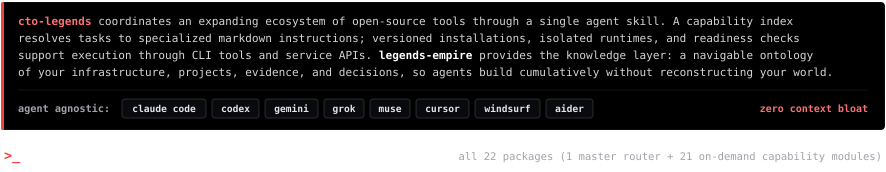</a>
  

  <a href="https://cto-legends.com/modules/cto-legends">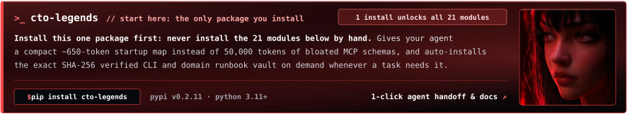</a>
  <a href="https://cto-legends.com/modules/legends-empire">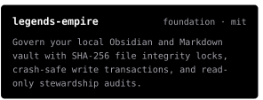</a>
  <a href="https://cto-legends.com/modules/legends-astro">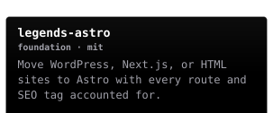</a>
  <a href="https://cto-legends.com/modules/legends-hetzner">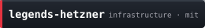</a>
  <a href="https://cto-legends.com/modules/legends-coolify">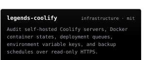</a>
  <a href="https://cto-legends.com/modules/legends-cloudflare">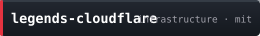</a>
  <a href="https://cto-legends.com/modules/legends-stripe">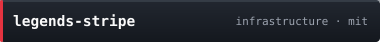</a>
  <a href="https://cto-legends.com/modules/legends-buzz">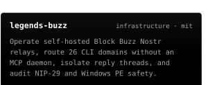</a>
  <a href="https://cto-legends.com/modules/legends-gohighlevel">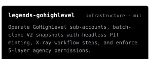</a>
  <a href="https://cto-legends.com/modules/legends-github">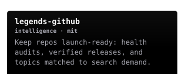</a>
  <a href="https://cto-legends.com/modules/legends-jev">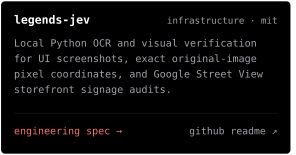</a>
  <a href="https://cto-legends.com/modules/legends-geogrid">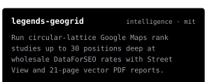</a>
  <a href="https://cto-legends.com/modules/legends-dataforseo">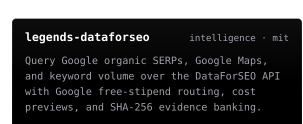</a>
  <a href="https://cto-legends.com/modules/legends-firecrawl">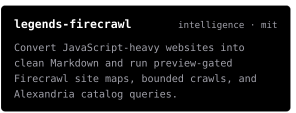</a>
  <a href="https://cto-legends.com/modules/legends-grant">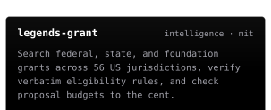</a>
  <a href="https://cto-legends.com/modules/legends-obs">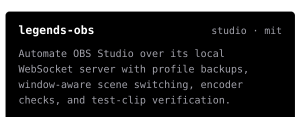</a>
  <a href="https://cto-legends.com/modules/legends-captions">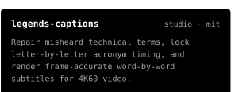</a>
  <a href="https://cto-legends.com/modules/legends-youtube">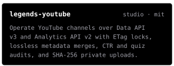</a>
  <a href="https://cto-legends.com/modules/legends-yt-dlp">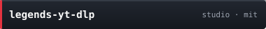</a>
  <a href="https://cto-legends.com/modules/legends-stable-audio-3">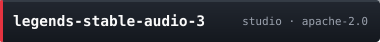</a>
  <a href="https://cto-legends.com/modules/legends-hyperyap">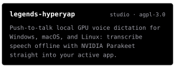</a>
  <a href="https://cto-legends.com/modules/legends-ambient-intelligence">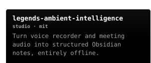</a>

