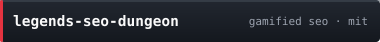

  

  
  

 

[cto-legends](https://github.com/avalonreset/cto-legends) coordinates an expanding ecosystem of open-source tools through a single agent skill. a capability index resolves tasks to specialized markdown instructions; versioned installations, isolated runtimes, and readiness checks support execution through command-line tools and service APIs. [legends-empire](https://github.com/avalonreset/legends-empire) provides the knowledge layer: a navigable ontology of your infrastructure, projects, evidence, and decisions. the objective is cumulative capability: agents that can operate your tools, retrieve prior knowledge, and continue building without reconstructing your world every session.

  agent agnostic:
  
  
  
  
  
  
  

---

### the ecosystem

<table width="100%">
<tr><td colspan="3"></td></tr>
<tr>
<td width="33.33%" valign="top">
  
  
the single local CLI router for claude code, codex, and cursor: reads one compact index and loads 19 isolated python tools on demand.

  
<a href="https://cto-legends.com/modules/cto-legends"><strong>master router spec →</strong></a> &nbsp;&middot;&nbsp; <a href="https://github.com/avalonreset/cto-legends#readme">github readme ↗</a>

</td>
<td width="33.33%" valign="top">
  
  
govern your local obsidian and markdown vault with SHA-256 integrity locks, crash-safe write transactions, and read-only stewardship audits.

  
<a href="https://cto-legends.com/modules/legends-empire"><strong>engineering spec →</strong></a> &nbsp;&middot;&nbsp; <a href="https://github.com/avalonreset/legends-empire#readme">github readme ↗</a>

</td>
<td width="33.33%" valign="top">
  
  
migrate wordpress, next.js, or legacy HTML sites to astro v7 with pre-build route and SEO parity contracts and post-build dist verification.

  
<a href="https://cto-legends.com/modules/legends-astro"><strong>engineering spec →</strong></a> &nbsp;&middot;&nbsp; <a href="https://github.com/avalonreset/legends-astro#readme">github readme ↗</a>

</td>
</tr>
<tr>
<td width="33.33%" valign="top">
  
  
scan live european and US hetzner cloud stock, compare cost-optimized x86 and ARM64 sizing, and enforce 10-check preflight provisioning plans.

  
<a href="https://cto-legends.com/modules/legends-hetzner"><strong>engineering spec →</strong></a> &nbsp;&middot;&nbsp; <a href="https://github.com/avalonreset/legends-hetzner#readme">github readme ↗</a>

</td>
<td width="33.33%" valign="top">
  
  
audit self-hosted coolify servers, docker container states, deployment queues, environment variable keys, and backup schedules over HTTPS.

  
<a href="https://cto-legends.com/modules/legends-coolify"><strong>engineering spec →</strong></a> &nbsp;&middot;&nbsp; <a href="https://github.com/avalonreset/legends-coolify#readme">github readme ↗</a>

</td>
<td width="33.33%" valign="top">
  
  
execute preview-first cloudflare DNS updates and cutovers that preserve orange-cloud proxy states, guard hostnames, and verify API readback.

  
<a href="https://cto-legends.com/modules/legends-cloudflare"><strong>engineering spec →</strong></a> &nbsp;&middot;&nbsp; <a href="https://github.com/avalonreset/legends-cloudflare#readme">github readme ↗</a>

</td>
</tr>
<tr>
<td width="33.33%" valign="top">
  
  
audit stripe .env price IDs, sync test and live price ladders, reconcile fixed-fee drag to the cent, and verify raw-body HMAC webhooks.

  
<a href="https://cto-legends.com/modules/legends-stripe"><strong>engineering spec →</strong></a> &nbsp;&middot;&nbsp; <a href="https://github.com/avalonreset/legends-stripe#readme">github readme ↗</a>

</td>
<td width="33.33%" valign="top">
  
  
operate gohighlevel sub-accounts, batch-clone V2 snapshots with headless PIT minting, X-ray workflow steps, and audit 5-layer agency RBAC.

  
<a href="https://cto-legends.com/modules/legends-gohighlevel"><strong>engineering spec →</strong></a> &nbsp;&middot;&nbsp; <a href="https://github.com/avalonreset/legends-gohighlevel#readme">github readme ↗</a>

</td>
<td width="33.33%" valign="top">
  
  
audit github repository health, package verified releases, align your 20 repo topics with search demand, and verify 1280x640 social previews.

  
<a href="https://cto-legends.com/modules/legends-github"><strong>engineering spec →</strong></a> &nbsp;&middot;&nbsp; <a href="https://github.com/avalonreset/legends-github#readme">github readme ↗</a>

</td>
</tr>
<tr>
<td width="33.33%" valign="top">
  
  
run local python OCR and visual verification for UI screenshots, exact original-image pixel coordinates, and street view signage audits.

  
<a href="https://cto-legends.com/modules/legends-jev"><strong>engineering spec →</strong></a> &nbsp;&middot;&nbsp; <a href="https://github.com/avalonreset/legends-jev#readme">github readme ↗</a>

</td>
<td width="33.33%" valign="top">
  
  
run circular-lattice google maps rank studies up to 30 positions deep at wholesale dataforseo rates with 18-page vector PDF audit reports.

  
<a href="https://cto-legends.com/modules/legends-geogrid"><strong>engineering spec →</strong></a> &nbsp;&middot;&nbsp; <a href="https://github.com/avalonreset/legends-geogrid#readme">github readme ↗</a>

</td>
<td width="33.33%" valign="top">
  
  
query google organic SERPs, google maps, and keyword volume over the dataforseo API with offline cost previews and SHA-256 local evidence.

  
<a href="https://cto-legends.com/modules/legends-dataforseo"><strong>engineering spec →</strong></a> &nbsp;&middot;&nbsp; <a href="https://github.com/avalonreset/legends-dataforseo#readme">github readme ↗</a>

</td>
</tr>
<tr>
<td width="33.33%" valign="top">
  
  
convert javascript-heavy websites into clean markdown and run preview-gated firecrawl site maps, bounded crawls, and alexandria queries.

  
<a href="https://cto-legends.com/modules/legends-firecrawl"><strong>engineering spec →</strong></a> &nbsp;&middot;&nbsp; <a href="https://github.com/avalonreset/legends-firecrawl#readme">github readme ↗</a>

</td>
<td width="33.33%" valign="top">
  
  
search federal, state, and foundation grants across 56 US jurisdictions, verify verbatim eligibility rules, and check budgets to the cent.

  
<a href="https://cto-legends.com/modules/legends-grant"><strong>engineering spec →</strong></a> &nbsp;&middot;&nbsp; <a href="https://github.com/avalonreset/legends-grant#readme">github readme ↗</a>

</td>
<td width="33.33%" valign="top">
  
  
automate OBS studio over its local websocket server with profile backups, window-aware scene switching, and hardware encoder verification.

  
<a href="https://cto-legends.com/modules/legends-obs"><strong>engineering spec →</strong></a> &nbsp;&middot;&nbsp; <a href="https://github.com/avalonreset/legends-obs#readme">github readme ↗</a>

</td>
</tr>
<tr>
<td width="33.33%" valign="top">
  
  
repair misheard technical terms, lock letter-by-letter acronym timing, and render frame-accurate word-by-word subtitles for 4K60 video.

  
<a href="https://cto-legends.com/modules/legends-captions"><strong>engineering spec →</strong></a> &nbsp;&middot;&nbsp; <a href="https://github.com/avalonreset/legends-captions#readme">github readme ↗</a>

</td>
<td width="33.33%" valign="top">
  
  
run a paced yt-dlp video, audio, and youtube transcript pipeline with resumable batch ledgers, GPU word alignment, and FFmpeg clip cuts.

  
<a href="https://cto-legends.com/modules/legends-yt-dlp"><strong>engineering spec →</strong></a> &nbsp;&middot;&nbsp; <a href="https://github.com/avalonreset/legends-yt-dlp#readme">github readme ↗</a>

</td>
<td width="33.33%" valign="top">
  
  
generate custom instrumental tracks on your local GPU with stable audio 3 and crossfade multi-hour background mixes with silence trimming.

  
<a href="https://cto-legends.com/modules/legends-stable-audio-3"><strong>engineering spec →</strong></a> &nbsp;&middot;&nbsp; <a href="https://github.com/avalonreset/legends-stable-audio-3#readme">github readme ↗</a>

</td>
</tr>
<tr>
<td width="33.33%" valign="top">
  
  
push-to-talk local GPU voice dictation for windows, macOS, and linux: transcribe speech offline with NVIDIA parakeet into your active app.

  
<a href="https://cto-legends.com/modules/legends-hyperyap"><strong>engineering spec →</strong></a> &nbsp;&middot;&nbsp; <a href="https://github.com/avalonreset/legends-hyperyap#readme">github readme ↗</a>

</td>
<td width="33.33%" valign="top">
  
  
offline voice memo and meeting transcription pipeline: archive USB voice recorders with SHA-256 deduplication and distill vault notes.

  
<a href="https://cto-legends.com/modules/legends-ambient-intelligence"><strong>engineering spec →</strong></a> &nbsp;&middot;&nbsp; <a href="https://github.com/avalonreset/legends-ambient-intelligence#readme">github readme ↗</a>

</td>
<td width="33.33%" valign="top">
  
  
turn technical website SEO audits into 16-bit turn-based dungeon battles with chiptune synth audio and exportable agent fix prompts.

  
<a href="https://github.com/avalonreset/legends-seo-dungeon"><strong>engineering spec →</strong></a> &nbsp;&middot;&nbsp; <a href="https://github.com/avalonreset/legends-seo-dungeon#readme">github readme ↗</a>

</td>
</tr>
</table>
